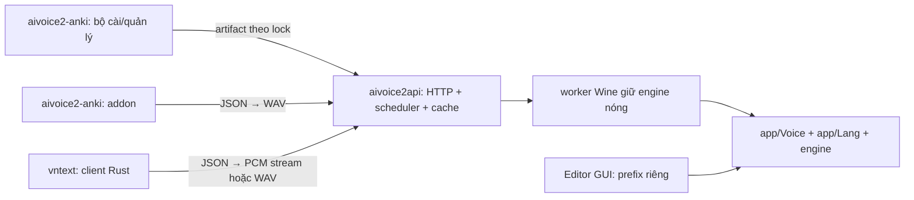

# Kiến trúc ba repo

Quyết định hiện hành ngày 2026-11-07. Một runtime TTS local phục vụ nhiều
client; tên repo backend chính là `aivoice2api`.

## Quyền sở hữu source và tài liệu

| Repo | Sở hữu | Không phát triển tại đó |
|---|---|---|
| `aivoice2api` | HTTP, worker C/ABI, scheduler, cache WAV, runtime config/CLI, registry nền, test backend, artifact và hợp đồng API | Addon Anki, game extractor, overlay, trình thiết lập Qt, patch GUI |
| `aivoice2-anki` | Addon/editor, media/card, trình thiết lập và quản lý giọng/service, build bundle, GUI helper/patch, tài liệu hỗ trợ và hồ sơ RE lịch sử | Bản fork backend |
| `vntext` | Nhận diện game, extract/OCR, dịch/tra từ, overlay, session TTS, prepare/lookahead, phát và cache RAM | Worker Wine, HTTP server hoặc cache WAV backend |

Ranh giới backend/manager: backend đọc cấu hình/registry để chạy; manager
đăng ký/gỡ giọng, chọn port và sinh service. Manager nhập runtime_config/CLI
của artifact được ghim, không tự duy trì một phiên bản support khác.

## Repo khác với runtime đã cài

Checkout chứa source. Release backend chứa worker đã build và support modules.
Setup Anki kết hợp artifact đó với GUI/addon để cài một root được quản lý:
`app/`, `runtime/`, `config/`, `prefixes/`, `manager/`, `backups/` và manifest.

Anki và vntext gọi cùng URL loopback đọc từ runtime.json; không giả định
17862 luôn đúng. Máy phát triển hiện dùng 17863. Mỗi instance có unit riêng
trong integration.json; hai client không cần hai service. Cùng một app
cung cấp Voice/Lang cho GUI và worker, hai Wine prefix giữ settings riêng.

Backend trả audio, client phát/dừng. Anki chỉ lưu media khi người dùng đồng
ý chèn. vntext giữ PCM/WAV nghe lại trong RAM; backend giữ WAV trên đĩa.
Không chuyển text game hàng loạt vào log hoặc đưa game/Anki collection vào repo.

## Phiên bản và tương thích

- `aivoice2api.lock.json` trong mỗi repo client ghi repo, version, commit,
  tên artifact và SHA-256. Lock là dependency đóng gói/QA, không phải cấu
  hình URL hoặc cơ chế tự cập nhật khi người dùng mở app.
- Anki dùng `/v1/speak` WAV. vntext thương lượng capabilities rồi dùng
  streaming/prepare hoặc lùi về WAV. API không tương thích cần version mới.
- Artifact backend là một bộ đồng bộ. Không trộn server mới/worker cũ.
- Binary Editor/engine, MSI, Lang và voicebanks cung cấp riêng. Việc tách
  repo không mở rộng baseline hash đã kiểm chứng hoặc sửa license/GUI.

## Trạng thái chuyển đổi

Source/test backend được chuyển từ vntext và support Anki sang repo này;
[PROVENANCE.md](PROVENANCE.md) giữ commit nguồn. Bản sao backend ở vntext
được gỡ, link cũ được chuyển hướng.

Anki giữ nguyên bundle 0.2.0 và developer-kit để checksum/evidence lịch sử
còn tái hiện được. Chúng là snapshot, không phải nguồn backend hiện hành.
`tools/prepare_setup.py` compose một setup mới từ template cũ và artifact
backend theo lock; sửa adapter tương thích tại tool này khi template đổi.
Không coi setup compose là đã nghiệm thu toàn bộ máy khách hoặc updater.

Runtime đang chạy trên máy không đổi chỉ vì tái tổ chức source/docs. Muốn
nâng cấp bản đã cài phải làm riêng theo hướng dẫn backup/verify/rollback.

## Khi thay đổi tính năng

| Thay đổi | Sửa/test chính | Tài liệu cần cập nhật |
|---|---|---|
| Worker, scheduling, protocol hoặc WAV quota | aivoice2api/runtime + tests | API/CONNECT/RELEASE; phát hành backend rồi cập nhật lock |
| Mic/dialog/editor và chèn media | Anki addon/tests | Anki ADDON; chỉ đổi backend khi API cần thay |
| Cài đặt, quản lý giọng, GUI helper | Anki setup/tools/tests | Anki INSTALLER/SUPPORT và evidence tương ứng |
| Overlay, extraction, lookahead, PipeWire | vntext src/tests | vntext TTS_CLIENT/engines/UI docs |

Mỗi loại hướng dẫn chỉ có một nguồn chính. Tài liệu lịch sử giữ ngày/commit
và giới hạn bằng chứng; không lấy một plan cũ làm đặc tả trạng thái hiện tại.
